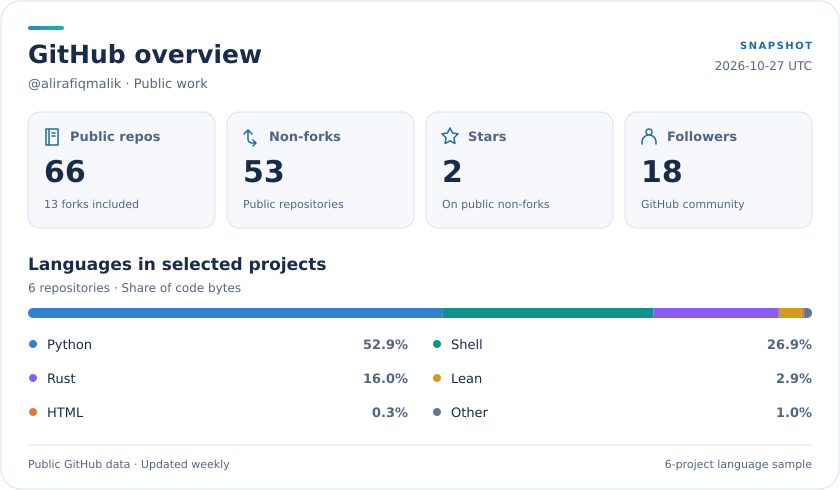

# Hi, I'm Ali 👋

**Ali Hamza Malik · PhD Candidate at UMass Amherst · Formal methods, security & research systems**

I investigate how banking, quantum, and communication systems can fail—and build tools to check their behavior. At the [Khwarizmi Lab](https://khwarizmilab.github.io/), I work with Muhammad Taqi Raza on security verification. My projects span theorem proving, protocol analysis, agent evaluation, local inference, and the hardware I started with.

[Research](#research--security) · [AI & HPC](#ai--research-computing) · [Tools](#developer--research-tools) · [Hardware](#hardware--embedded-systems) · [More projects](#more-projects)

## Start here

- 🔬 **[Certified Confinement](https://github.com/alirafiqmalik/certified-confinement-acm-pqqs-26-artifacts)** — Lean 4 proofs and reproducible checks for tenant confinement in quantum-cloud circuits. [Paper](https://doi.org/10.1145/3839338.3857240).
- 🏦 **[Credit Without Debit](https://github.com/alirafiqmalik/ach-model-checking)** — the ACM CCS 2026 banking-protocol artifact: executable ACH models, invariant checks, and counterexamples.
- 🖥️ **[Unity HPC Controller](https://github.com/alirafiqmalik/unity-hpc-controller)** — submit reproducible Slurm campaigns, recover interrupted attempts, and retrieve results incrementally.
- 🧩 **[FSM Visual Tool](https://github.com/alirafiqmalik/fsm-tool)** — draw communicating state machines in the browser, edit DOT, and export SVG or draw.io diagrams.

## Research & security

### Formal verification & quantum systems

- 🔬 **[Certified Confinement](https://github.com/alirafiqmalik/certified-confinement-acm-pqqs-26-artifacts)** — check transpiler output against device connectivity and forbidden qubit regions, with a Lean-checked soundness theorem. Structural confinement; physical crosstalk is outside the guarantee.
- 🏦 **[ACH Model Checking](https://github.com/alirafiqmalik/ach-model-checking)** — nuXmv, IC3, and bounded model checking for payment invariants, with reproduction scripts and saved reference results.
- ⚛️ **[Tamarin Quantum Protocol Bench](https://github.com/alirafiqmalik/tamarin-quantum-protocol-bench)** — assemble symbolic quantum-protocol models, inspect generated theories, and check lemmas; a PQQS 2026 demo.
- 🔐 **[Beyond the Quantum Promise](https://github.com/alirafiqmalik/qkd-fv-ieee-qce-demo)** — interactive web companion to my IEEE QCE 2026 talk, explaining QKD's classical control plane through an attack walkthrough.
- 🧮 **[FV_GPU](https://github.com/alirafiqmalik/FV_GPU)** — experimental formal-verification workspace containing a Python SMT translation prototype and upstream prover sources.

### Communication & network security

- 📲 **[eSIM Research Tools](https://github.com/alirafiqmalik/esim-research-tools)** — inspect Android eSIMs, capture provisioning flows, generate protocol diagrams, and explore a local ecosystem simulator.
- 📶 **[Bluetooth Testbed](https://github.com/alirafiqmalik/bluetooth-tesbed)** — investigate multipoint audio switching with capture tools, SAPIC+ models, and device experiments.
- 📡 **[NAS/RRC Control-Plane Monitor](https://github.com/alirafiqmalik/nasrrc-control-plane-monitor-analysis)** — capture and decode cellular signaling on a supported rooted Pixel; inspect measurement reports and handovers.
- 🛡️ **[SDN Intrusion Detection](https://github.com/alirafiqmalik/SDN-Based-Machine-Learning-IDS)** — machine-learning experiments for network intrusion detection using Mininet, Ryu, and CloudLab.

### Hardware security

- 🔒 **[ENIGMA](https://github.com/alirafiqmalik/ENIGMA-Logic-Locking-Framework)** — logic-locking framework for Verilog circuits, with netlist parsing, locking transformations, and verification tools.
- 🔍 **[Logic Locking Lab](https://github.com/alirafiqmalik/logic-locking-lab)** — gate-level circuit transformations, BENCH/Verilog conversion, and oracle-guided SAT attacks from my final-year research.

## AI & research computing

- 🖥️ **[Unity HPC Controller](https://github.com/alirafiqmalik/unity-hpc-controller)** — Python/Slurm orchestration with frozen source bundles, GPU-aware placement, a durable SQLite journal, and CLI/MCP interfaces.
- 🧪 **[Agent Eval HPC](https://github.com/alirafiqmalik/agent-eval-hpc)** — configurable agent trials using Harbor, Apptainer, and local model serving, with inspectable trajectories and scoring artifacts.
- 🔀 **[Local Model Router](https://github.com/alirafiqmalik/local-model-router)** — one local chat API for Ollama and Hugging Face, with heuristic routing, streaming, and a resource dashboard.
- 🧠 **[LogicTune](https://github.com/alirafiqmalik/LogicTune)** — experimental DPO fine-tuning of control policies using formal-verifier feedback; includes a measured run and analysis of its lack of improvement.
- 📚 **[NeetCode GPT](https://github.com/alirafiqmalik/neetcode-gpt)** — a GPT implementation assembled from my ML coursework, from neural-network fundamentals to attention and text generation.

## Developer & research tools

- 🧩 **[FSM Visual Tool](https://github.com/alirafiqmalik/fsm-tool)** — Svelte/TypeScript editor for Mealy, Moore, and communicating machines, with Graphviz layouts and portable diagram exports.
- 📄 **[PDF Tutor](https://github.com/alirafiqmalik/cf_ai_mini_pdf_tutor)** — study PDFs with page summaries, quizzes, and notes, built with Cloudflare Workers AI and R2.
- 📝 **[ResumeBuilder](https://github.com/alirafiqmalik/ResumeBuilder)** — generate LaTeX resumes from YAML, choosing content, layouts, and themes for different roles.
- 📅 **[Security Deadlines](https://github.com/alirafiqmalik/sec-deadlines)** — adapted conference-deadline site with topic filters and venue submissions, based on the community deadline projects.
- 🌐 **[Personal Website](https://github.com/alirafiqmalik/alirafiqmalik.github.io)** — my Jekyll portfolio, with publications, project filtering, and dark mode. [Visit](https://alihamzamalik.me/).

## Hardware & embedded systems

My earlier engineering work includes individual and team projects in digital design, robotics, and signal processing.

- ⚙️ **[RV32I Processor on FPGA](https://github.com/alirafiqmalik/rv32i-processor-fpga)** — undergraduate Verilog processor project for Intel Cyclone V, with datapath documentation and CoreMark integration.
- 💻 **[Nucore Microprocessor](https://github.com/alirafiqmalik/Nucore-microprocessor)** — Verilog processor coursework with ALU, register-file, control, and instruction-memory modules.
- ⭕ **[Bresenham Circle Accelerator](https://github.com/alirafiqmalik/Bresenham-Circle-Algorithm-Hardware-Accelerator)** — FPGA circle rendering with Verilog modules, VGA output, and testbenches.
- ✏️ **[CNC Drawbot](https://github.com/alirafiqmalik/CNC-controller)** — Arduino-based drawing machine that translates G-code into stepper-motor motion.
- 🚁 **[Event-Driven Swarm Configuration](https://github.com/alirafiqmalik/Event-Driven-Swarm-Configuration)** — collaborative UAV swarm-coordination project from my robotics research.
- 🦾 **[Robotic Arm](https://github.com/alirafiqmalik/Robotic-Arm)** — microcontroller project with separate transmitter and receiver firmware and Proteus design files.
- 🚨 **[ESP32 Fire-Alarm Detector](https://github.com/alirafiqmalik/Real-time-Fire-Alarm-Detector-using-ESP32)** — FFT-based sound detection with an ESP32-hosted web display.

## More projects

This README links all **66 public repositories** on my account as of **October 27, 2026**. Expand the groups below for earlier projects, research references, forks, and supporting repositories. [Browse the latest inventory](https://github.com/alirafiqmalik?tab=repositories).

<strong>Earlier software, signal processing & coursework</strong>

- 🕰️ **[Assembly Clock](https://github.com/alirafiqmalik/Assembly-Clock)** — graphical analog clock in x86 assembly, designed to run in DOSBox.
- ☎️ **[DTMF Encoder/Decoder](https://github.com/alirafiqmalik/DTMF-ENCODER-DECODER)** — MATLAB tone generation, filtering, and digit decoding.
- 📊 **[FFT Display](https://github.com/alirafiqmalik/FFT-Display)** — signal-visualization coursework with MATLAB and Processing scripts.
- 🎵 **[Music Player](https://github.com/alirafiqmalik/MUSIC-PLAYER)** — MATLAB audio player with filtering and sound effects.
- 💧 **[Water Flow Management System](https://github.com/alirafiqmalik/Water-Flow-Managment-System)** — digital-logic project with a Proteus design, report, and presentation.
- 🔊 **[TCP Audio Transfer](https://github.com/alirafiqmalik/TCP-audio-file-Transfer-in-C)** — C client/server code for transferring audio files over TCP.
- 💬 **[CodeFest '21 Chatbot](https://github.com/alirafiqmalik/CodeFest-21-ChatBot)** — intent-based chatbot project with Python model code and a PHP web interface.
- 🎮 **[Tic-Tac-Toe AI](https://github.com/alirafiqmalik/TicTacToe-AI-opponent)** — browser game with a JavaScript opponent.
- 📑 **[Plagiarism Checker](https://github.com/alirafiqmalik/Plagarism-Checker)** — small C++ text-comparison exercise.
- 🌳 **[Data Structures & Algorithms](https://github.com/alirafiqmalik/Data-Structures-and-alogrithms)** — C++ exercises in stacks, expression evaluation, search trees, and sorting.
- 🎓 **[TUKL Internship](https://github.com/alirafiqmalik/TUKL-Internship)** — text-classification experiments with embeddings, sequence classifiers, SVM, and Naive Bayes.
- 📥 **[Data Scraping](https://github.com/alirafiqmalik/Data-Scraping)** — Python document-download scripts, including a multiprocessing PDF downloader.
- 🕸️ **[Web Scraping](https://github.com/alirafiqmalik/Web-Scraping)** — Python/JavaScript scripts and notebooks for collecting web text, images, and links.

<strong>Research references, reproductions & archived notes</strong>

These repositories collect reference implementations, upstream code, and exploratory work. See each repository for its original credits and scope.

- 🔐 **[KEMTLS / TLS 1.3 Tamarin](https://github.com/alirafiqmalik/KEMTLS-TLS13Tamarin-kem-auth)** — reference copy of KEMTLS protocol models derived from TLS13Tamarin.
- 🔒 **[neos](https://github.com/alirafiqmalik/neos)** — copy of Kaveh Shamsi's netlist obfuscation/deobfuscation suite.
- 🧮 **[SAT Sources](https://github.com/alirafiqmalik/SAT_src)** — SAT-tool source and build workspace with logic-locking benchmarks and solver dependencies.
- 🔗 **[Repeater Chain Optimisation](https://github.com/alirafiqmalik/RepeaterchainOptimisation)** — quantum-repeater protocol optimization code with paper-reproduction configurations.
- ⚛️ **[simQKD](https://github.com/alirafiqmalik/simQKD)** — collection of QKD simulator resources, source references, and documentation.
- 🖼️ **[MMSegmentation for Kaggle](https://github.com/alirafiqmalik/mmsegmentation)** — my copy of OpenMMLab's semantic-segmentation toolkit for Kaggle work.
- 📓 **[QKD Formal-Verification Notes](https://github.com/alirafiqmalik/notes-QKD-FV)** — archived models, experiments, and notes from earlier quantum-protocol work.

<strong>Public forks</strong>

Forks of other teams' projects, listed separately from my own work; inclusion here does not imply an upstream contribution.

- 📡 **[5GReasoner](https://github.com/alirafiqmalik/5GReasoner)** — formal analysis of 5G protocols.
- 🧠 **[ProtocolGPT](https://github.com/alirafiqmalik/ProtocolGPT)** — infer protocol state machines from implementations with language models.
- ⚛️ **[queer](https://github.com/alirafiqmalik/queer)** — quantum-routing simulations.
- 🖼️ **[Swin Transformer Semantic Segmentation](https://github.com/alirafiqmalik/Swin-Transformer-Semantic-Segmentation)** — upstream Swin-based segmentation implementation.
- ⚡ **[Model Optimizer](https://github.com/alirafiqmalik/Model-Optimizer)** — NVIDIA's model-compression and inference-optimization toolkit.
- 🔀 **[NIXL](https://github.com/alirafiqmalik/nixl)** — NVIDIA Inference Xfer Library.
- 📚 **[Reasoning from Scratch](https://github.com/alirafiqmalik/reasoning-from-scratch)** — step-by-step reasoning-model implementation in PyTorch.
- ⌨️ **[Claude Code](https://github.com/alirafiqmalik/claude-code)** — terminal-based coding agent.
- 🤖 **[TinyAGI](https://github.com/alirafiqmalik/tinyagi)** — agent-team orchestration.
- 💼 **[Career Ops](https://github.com/alirafiqmalik/career-ops)** — local job-search and application workflows.
- 🧰 **[MixtapeTools](https://github.com/alirafiqmalik/MixtapeTools)** — tools for coding, teaching, and presentations.
- 📖 **[LNReader](https://github.com/alirafiqmalik/lnreader)** — Android light-novel reader.
- 🏛️ **[Khwarizmi Lab Website](https://github.com/alirafiqmalik/KhwarizmiLab.github.io)** — fork of the lab's website.

<strong>Profile, site history & placeholders</strong>

- 👋 **[This Profile](https://github.com/alirafiqmalik/alirafiqmalik)** — this README and its local statistics-generation workflow.
- 🎨 **[Website Prototype](https://github.com/alirafiqmalik/new_website_version_temp)** — earlier portfolio UI workspace.
- 🗄️ **[Archived Website](https://github.com/alirafiqmalik/_bkkup_old_alirafiqmalik.github.io)** — archived personal-site backup.
- ☁️ **[cloud-lab-project](https://github.com/alirafiqmalik/cloud-lab-project)** — empty public placeholder.
- 🏗️ **[qfml-setup](https://github.com/alirafiqmalik/qfml-setup)** — empty public placeholder.

## GitHub stats

<picture>
  <source media="(prefers-color-scheme: dark) and (max-width: 600px)" srcset="profile/portfolio-stats-mobile.svg" />
  <source media="(max-width: 600px)" srcset="profile/portfolio-stats-mobile-light.svg" />
  <source media="(prefers-color-scheme: dark)" srcset="profile/portfolio-stats.svg" />
  
</picture>

About the numbers · sources & scope

Account totals cover public repositories; stars exclude forks. Non-forks can include upstream copies. The language chart covers Certified Confinement, ACH Model Checking, Unity HPC Controller, Agent Eval HPC, Local Model Router, and eSIM Research Tools. Percentages use GitHub-reported code bytes, including any counted vendor code, and describe repository composition rather than personal contribution.

The card refreshes weekly. [Snapshot data](profile/portfolio-stats.json) · [Generation script](scripts/profile_stats.py)

---

Interested in formal verification, protocol security, or research infrastructure? **[Let's connect](mailto:ahmalik@umass.edu).**
