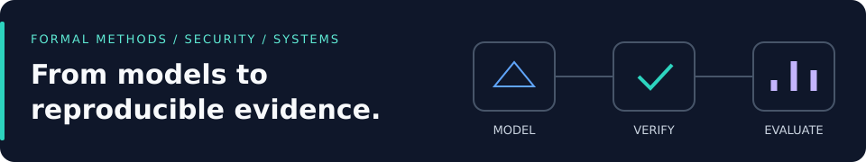
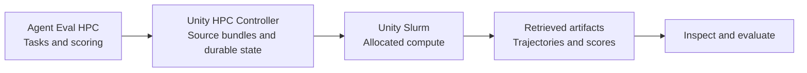
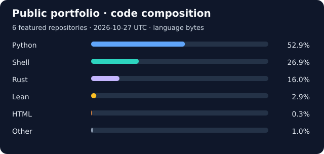

# Ali Hamza Malik

**PhD researcher at UMass Amherst · Formal verification · Quantum security · Research infrastructure**

I study the security of quantum systems and communication protocols in the [Khwarizmi Lab](https://khwarizmilab.github.io/), advised by Muhammad Taqi Raza. I build formal models, executable research artifacts, and the infrastructure to run and inspect experiments—from Lean proofs and protocol analysis to GPU campaigns and local inference.

[Website](https://alihamzamalik.me/) · [Google Scholar](https://scholar.google.com/citations?user=Vw4_jN4AAAAJ&hl=en) · [LinkedIn](https://www.linkedin.com/in/alihamzamalik/) · [Email](mailto:ahmalik@umass.edu)

## Selected research

### Certified Confinement · Quantum-cloud security

**Can a hardware-legal circuit still cross a tenant boundary?** This artifact checks untrusted transpiler output against device connectivity and a forbidden qubit region. Its Lean 4 soundness theorem connects acceptance to hardware legality and support confinement for the represented circuit.

The repository includes a staged reproduction runner, benchmark data, and IBM hardware evidence. The recorded evaluation covers **11 device topologies and 44 independently recomputed verdicts**; the structural guarantee does not bound physical crosstalk.

[Source & quick start](https://github.com/alirafiqmalik/certified-confinement-acm-pqqs-26-artifacts) · [Paper — ACM PQQS ’26](https://doi.org/10.1145/3839338.3857240) · [Paper-to-code guide](https://github.com/alirafiqmalik/certified-confinement-acm-pqqs-26-artifacts/blob/main/docs/PAPER.md)

### Credit Without Debit · Banking protocol verification

Formal models and reproduction scripts for *Credit Without Debit: Formal Verification of Banking Payment Systems* (ACM CCS 2026). The artifact uses **nuXmv, IC3, and bounded model checking** to examine ACH payment flows, with reference results and counterexamples for three payment invariants.

[Source & reproduction guide](https://github.com/alirafiqmalik/ach-model-checking) · [Reference results](https://github.com/alirafiqmalik/ach-model-checking/tree/main/saved-reference-results)

## Selected engineering

| Project | What you can inspect | Stack |
| :--- | :--- | :--- |
| **[Unity HPC Controller](https://github.com/alirafiqmalik/unity-hpc-controller)** | Headless experiment orchestration: immutable source bundles, hardware-aware placement, durable attempts, and incremental result retrieval. [Architecture](https://github.com/alirafiqmalik/unity-hpc-controller/blob/main/ARCHITECTURE.md) | Python · Slurm · SQLite · HTTP / MCP |
| **[Agent Eval HPC](https://github.com/alirafiqmalik/agent-eval-hpc)** | Configurable agent evaluations with isolated trials, local inference, and inspectable trajectories. Includes **164 HumanEval tasks and 581 Verus SpecGym tasks**. [Experiments](https://github.com/alirafiqmalik/agent-eval-hpc/tree/main/experiments) | Python · Harbor · Apptainer · vLLM |
| **[Local Model Router](https://github.com/alirafiqmalik/local-model-router)** | A local chat API routing requests to Ollama or a Hugging Face engine, with heuristic model selection, streaming, and a resource dashboard. [Dashboard & quick start](https://github.com/alirafiqmalik/local-model-router#readme) | Python · FastAPI · Ollama · Hugging Face |
| **[eSIM Research Tools](https://github.com/alirafiqmalik/esim-research-tools)** | Device inspection, provisioning capture, protocol diagrams, fuzzing harnesses, and a local eSIM ecosystem simulator. [Research capabilities](https://github.com/alirafiqmalik/esim-research-tools#research-capabilities) | Python · Android / ADB · Graphviz |

### From experiment to evidence

The public HPC projects cover complementary layers: **Agent Eval HPC** defines and evaluates trials; **Unity HPC Controller** manages campaign execution and result retrieval.

## More to explore

- **[Tamarin Quantum Protocol Bench](https://github.com/alirafiqmalik/tamarin-quantum-protocol-bench)** — PQQS 2026 demonstration for assembling symbolic quantum-protocol models, checking lemmas, and comparing modeling choices.
- **[Beyond the Quantum Promise](https://github.com/alirafiqmalik/qkd-fv-ieee-qce-demo)** — interactive web companion to an IEEE QCE 2026 talk on classical control in QKD; includes a step-by-step attack walkthrough.
- **[RV32I Processor on FPGA](https://github.com/alirafiqmalik/rv32i-processor-fpga)** — undergraduate Verilog processor project targeting Intel Cyclone V, with datapath documentation and synthesis results.

## GitHub stats

A dated snapshot of the two research artifacts and four engineering projects above. Percentages use GitHub-reported language bytes, including any vendored code GitHub counts; they describe repository composition, not proficiency or personal contribution. Forks, private repositories, and other projects are outside this selection. [Data & collection date](profile/portfolio-stats.json) · [Regeneration script](scripts/profile_stats.py)

---

**Interested in formal methods, security research, or research systems?** [Get in touch](mailto:ahmalik@umass.edu) or explore my [publications](https://scholar.google.com/citations?user=Vw4_jN4AAAAJ&hl=en).
